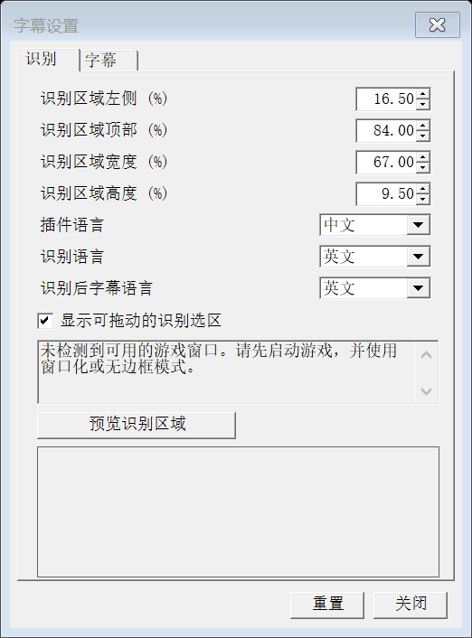
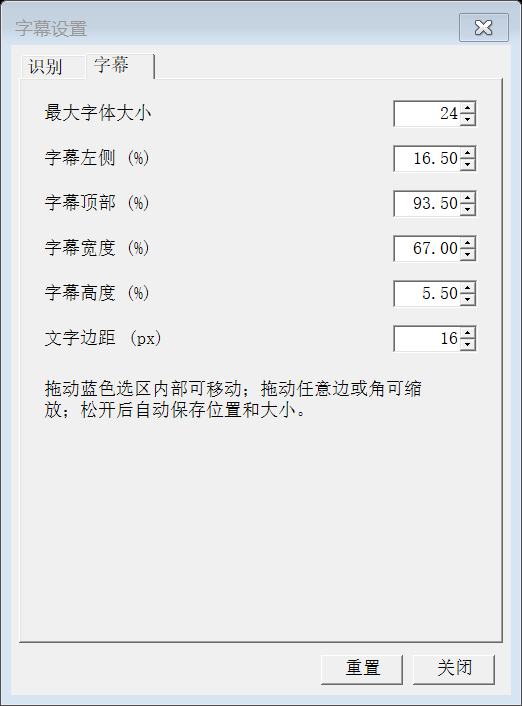

# 原神中英字幕覆盖工具

非官方 Windows 外部 OCR 字幕覆盖工具。截取游戏字幕区域，使用 Windows OCR 识别，再在本地官方 TextMap 索引中查询配对的中文和英文。原游戏字幕仍然存在；本工具不修改游戏文件、不读写游戏内存、不注入游戏，也不调用在线翻译 API。

当前版本：**v0.1.0-beta.1 本地发布候选**。代码许可证和版权署名尚待维护者确认，尚未公开发布。请勿将本地候选包误认为已经授权开源的正式 Release。



图为工具自检生成的设置窗口，仅含默认设置，不包含玩家截图或个人信息。

## 环境要求

- Windows 10/11 x64，Windows PowerShell **5.1**、系统 WinForms / Windows OCR。
- Python **3.9+**，包含标准库 `sqlite3`。推荐官方 Python 安装，勾选添加到 PATH；不需要 pip 包、Codex 或开发者缓存。
- Windows 中文、英文 OCR 语言组件，推荐都安装。仅有其中一种时保留备用引擎行为，识别另一种语言的质量可能下降。
- 首次下载需要网络和系统 `curl.exe`；至少预留 1 GB 可用空间用于四份 TextMap、索引和临时重建。
- 推荐窗口化或无边框游戏窗口。独占全屏、特殊缩放、多屏或受限桌面需要实际验证。

## 首次安装

1. 将源码/公开 ZIP 解压到一个自己可写的目录；路径可以有空格。不必放在游戏安装目录。
2. 安装 Python。Windows“设置 → 时间和语言 → 语言和区域”安装简体中文、英语及其基本输入/OCR 组件；若系统未提供组件，先查看 [排障](#常见问题)。本工具不自动安装或提权。
3. 双击根目录 **`setup.bat`**，等待各阶段完成。也可运行：

```powershell
powershell.exe -NoProfile -ExecutionPolicy Bypass -File .\GenshinSubtitles\setup.ps1
```

设置入口会检查 PowerShell、Python、OCR，下载并校验同一固定提交的 **四份** TextMap，然后准备和检查 SQLite。数据有效时不会重复下载，索引版本、来源指纹和完整性有效时不会重建。部分下载或校验失败会明确失败，修复网络后可重跑。

Python 依次从 `GENSHIN_SUBTITLES_PYTHON`、工具目录 `.venv/Scripts/python.exe`、`runtime/python/python.exe`、PATH 的 Python / `py -3` 查找。可显式设置环境变量指向自己的 `python.exe`，不需要修改源码。

## 日常启动

先用日常启动器打开原神，再双击 **`GenshinSubtitles/launcher.bat`**。启动器会显示缺依赖或数据过期提示；按提示运行 `setup.bat`。日常截图、OCR、查库均在本地运行。

可选：把游戏 EXE 拖到 `launcher.bat`，或在旁边 `game-path.txt` 第一行写自己的完整 EXE 路径（不加引号），或设 `GENSHIN_GAME_EXE`。优先级为参数 → 环境变量 → 文件，无内置机器游戏路径。推荐优先用正常游戏启动器。

没有可用游戏窗口、窗口最小化/关闭时识别暂停，旧字幕清空。工具栏仍可操作。窗口恢复后自动重新识别。工具无法代替游戏的正常启动或权限配置。

## 三项语言与操作

| 设置 | 作用 | 新配置默认 |
|---|---|---|
| 插件语言 | 设置页、按钮和状态提示 | 中文 |
| 识别语言 | 游戏当前原字幕语言、OCR 引擎和查询方向 | 英文 |
| 识别后字幕语言 | 在覆盖层显示中文或英文 | 英文 |

- `开/关`（英文 ON/OFF）或 **Ctrl+Shift+T** 开关识别和字幕。
- `ZH/EN` 或 **Ctrl+Shift+Y** 切换显示语言，并保存设置。
- 打开 **SET/设置** 后，自动识别暂停；黄色 OCR 框仅在设置页打开且勾选“显示可拖动的识别选区”时出现。
- 蓝色字幕选区、黄色 OCR 选区均支持内部拖动、四边/四角缩放，松手自动保存。正常显示是无背景、无描边、鼠标穿透的纯文字。
- “预览识别区域”临时隐藏设置与选区后截图，检查是否只覆盖原字幕。无有效游戏窗口时不截取桌面备用区域。
- 工具栏左侧把手拖动，右侧收起为小图标；小图标可拖动、点击恢复。收起不停止识别，位置和收起状态持久化。
- 默认 OCR 区域为左/上/宽/高 `16.5 / 84 / 67 / 9.5%`，字幕区域 `16.5 / 93.5 / 67 / 5.5%`；最大字号 24、内边距 16 px，长文本会缩至最低 8。极小区域仍可能放不下全部文本。



匹配成功后，中文和英文都从**同一条配对记录**取得官方原文（保留原始空格、标点与模板标记）。检索用归一化文本不作为官方原文显示。未匹配时：显示语言与识别语言相同则回退 OCR，显示对向语言则为空。相似度是字符串匹配分数，**不是校准后的置信概率**。

## 数据版本与手动更新

来源：社区提取 `DimbreathBot/AnimeGameData`，固定提交 `9587d1afbd9ab0419cdd00dc05ecd114b9e3fe99`，标记 `CNRELWin7.1.0_R48145775_S48131320_D48145775`。

清单在 `GenshinSubtitles/data/sources.json`。主包 `TextMapCHS/EN.json` 与 `TextMap_MediumCHS/EN.json` **必须成对且同版本使用**。Medium 不可省略。版本标记不保证覆盖所有后续热更新。

维护者更新时，先核对可信来源中同一提交的四个文件、字节数和 Git blob SHA-1，再修改清单。关闭覆盖层、另行备份原有四文件，将它们移出 data，运行 `setup.bat` 下载并重建。也可运行 `fetch-data.ps1` 后 `prepare-ocr-index.ps1`。不要混放不同版本的中英文数据；失败时不换用未经验证的来源。索引 v2 包含原文和内容指纹，旧索引需要一次重建。

TextMap 与 SQLite 不随源码/公开包分发；游戏文本的权属独立于工具代码，见 [THIRD_PARTY.md](GenshinSubtitles/THIRD_PARTY.md)。

## 常见问题

- **找不到 Python**：在终端运行 `py -3 --version` 或 `python --version`，确认是真正可执行的 Python；必要时用 `GENSHIN_SUBTITLES_PYTHON` 指定路径。Windows Store 占位别名不代表已经安装。
- **OCR 语言缺失**：在语言选项安装相应组件。可在你自己打开的管理员 Windows PowerShell 中用 `Get-WindowsCapability -Online` 查询包含 `Language.OCR` 的条目，再安装所需语言；工具不会替你执行系统安装或提权。
- **没有字幕/未匹配**：确认识别语言和实际游戏语言相同，预览是否框住完整字幕；检查 Medium 分包。库里不存在的对白不会机器翻译。十个或更少可见字符的片段目前跳过，昵称、按键提示、相似重复对白仍可能影响结果。
- **窗口不可用**：先打开/还原游戏，尝试无边框/窗口化；设置页会给出暂停原因。不会把整个桌面当成游戏继续识别。
- **字体小/长句放不下**：扩大字幕选区，减小文字边距；更换分辨率或缩放后重新校准。
- **配置损坏**：原文件保留且禁止本轮保存；退出工具，备份后修复或重命名 `data/overlay-settings.json` 再启动。正常保存采用同目录临时文件替换，并保留上一次 `.bak`；旧 `SourceLanguage` 会迁移为识别语言。
- **下载失败**：保持失败提示，检查网络后重跑。只访问清单固定提交的原始文件及同一 Git blob 的 GitHub API 回退地址，不会悄悄改来源。
- **启动窗口一闪而过**：用 Windows PowerShell 5.1 运行下面的 CheckOnly 查看报错；启动器失败分支会停留。启动预检日志在 `%TEMP%/genshin-overlay-check.log`，运行错误在工具目录 `overlay-errors.log`。

## 验证与反馈

```powershell
powershell.exe -NoProfile -ExecutionPolicy Bypass -File .\GenshinSubtitles\check-environment.ps1 -RunTests
powershell.exe -NoProfile -ExecutionPolicy Bypass -File .\GenshinSubtitles\overlay.ps1 -CheckOnly
powershell.exe -NoProfile -ExecutionPolicy Bypass -File .\GenshinSubtitles\overlay.ps1 -UiCheck
```

UiCheck 使用随机独立配置目录，不读取或覆盖真实个人设置。它会短暂显示测试窗口并检查控件交互，不代表游戏内手动验收。[验证记录](docs/VALIDATION.md) 区分自动测试、本机干净目录测试和待手动项目。

反馈时请提供：Windows 版本、工具版本、数据提交、三项语言、分辨率/缩放/窗口模式、OCR 实际文本、期待的台词和错误信息。截图请自行遮盖 UID、昵称及其他个人信息，不要上传完整 TextMap、数据库或个人设置。

## 已知限制与后续

- 不保证所有任务、短句、热更新对白、分辨率或窗口模式；中文/英文模糊候选与阈值沿用现有规则。
- 相同检索键保留第一条记录，重复台词消歧仍可能选错上下文；暂不重做索引算法。
- 单个后台扫描包含 PowerShell/OCR 初始化开销，优先保证界面响应与可靠回收；不引入常驻服务或大规模性能改造。
- 不提供独立 EXE、安装器、自动数据更新、在线翻译或其他语言扩展。
- 实际游戏内识别、语言切换、拖动缩放和多屏体验仍需用户手动验收。

开发地图、测试和公开打包见 [DEVELOPMENT.md](docs/DEVELOPMENT.md)。
